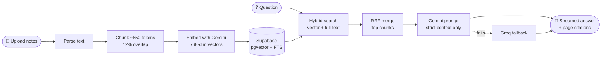
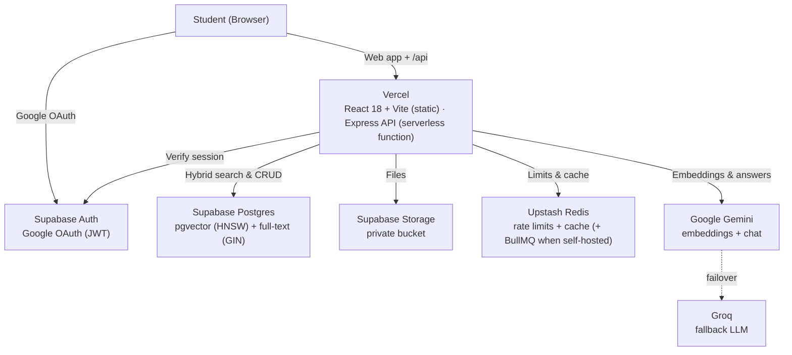

<div align="center">


<a href="https://github.com/Aman739-code/AskMyNotes">
  
</a>

<br/><br/>

[](https://askmynotes-puce.vercel.app)
[](https://github.com/Aman739-code/AskMyNotes/stargazers)
[](#-license)


</div>

---

## ✨ What is AskMyNotes?

AskMyNotes is a multi-tenant **document Q&A and active-recall platform for students**. Upload lecture notes, ask questions across your documents, and get **streamed answers with exact page-level citations**, then turn the same notes into flashcards and quizzes.

If the answer isn't in your notes, it says so. No guessing, no made-up sources.

```text
┌──────────────────────────────────────────────────────────────────────────────┐
│  AskMyNotes · BIO-201_Cell_Biology_Final.pdf                                 │
├──────────────────────────┬─────────────────────────────────┬─────────────────┤
│  RETRIEVAL SCOPE         │  CONVERSATION                   │ CITATION SOURCE │
│                          │                                 │                 │
│  [✓] All Documents (3)   │  Student:                       │ § Glycolysis    │
│  [ ] Lecture 4 - Bio.pdf │  What is the rate-limiting      │ Page 14         │
│  [ ] Macro Chapter 5.md  │  enzyme of glycolysis?          │                 │
│                          │                                 │ "Phosphofructo- │
│  ACTIONS                 │  AskMyNotes:                    │ kinase-1 (PFK-1)│
│  + New Chat              │  The rate-limiting enzyme is    │ is the primary  │
│  ⚙ Flashcards & Quiz     │  PFK-1 [p.14 · BIO-201.pdf] ──► │ pacemaker..."   │
└──────────────────────────┴─────────────────────────────────┴─────────────────┘
```

---

## 🚀 Features

| | Feature | Details |
|---|---|---|
| 🔐 | **Google sign-in & private workspaces** | Supabase Auth with isolated per-user data |
| 📄 | **Smart ingestion** | PDF, TXT and MD up to 10 MB; text is split into ~650-token chunks with 12% overlap, SHA-256 hashed, and embedded (768-dim) |
| 🔎 | **Hybrid retrieval** | pgvector cosine similarity + Postgres full-text search, merged with Reciprocal Rank Fusion (`k = 60`) |
| ⚡ | **Streaming answers** | Server-Sent Events, with clickable `[p.14 · file.pdf]` citation chips that open the source passage |
| 🧮 | **Math-ready answers** | Markdown + LaTeX (KaTeX) rendering for formulas |
| 🃏 | **Flashcards** | One-click decks with flip animation and *Again / Got it* ease tracking |
| 📝 | **Quizzes** | Multiple-choice questions with instant grading and explanations |
| 🛡️ | **Row Level Security** | Enforced on every table and on private storage, so cross-user access is not possible |
| 🚦 | **Rate limiting & caching** | Sliding-window limits and answer caching on Upstash Redis |
| 🔁 | **LLM failover** | If Gemini fails, requests fall back to Groq automatically |

---

## 🧠 How it works



### System architecture



---

## 🛠️ Tech stack

| Layer | Tools |
|---|---|
| **Frontend** | React 18, Vite, TypeScript (strict), Tailwind CSS, React Router, TanStack Query, Zustand, react-markdown, KaTeX, Lucide |
| **Backend** | Node.js, Express, TypeScript (strict), Zod, Pino, Multer, `pdf-parse` |
| **Data & auth** | Supabase Postgres, pgvector (HNSW), GIN full-text index, Row Level Security, Supabase Auth and Storage |
| **Queue & cache** | Upstash Redis, BullMQ (worker mode) |
| **AI** | Google Gemini (`gemini-embedding-001` embeddings, `gemini-flash-lite-latest` chat) with Groq fallback |
| **Quality** | Vitest, Supertest, ESLint, GitHub Actions |
| **Monorepo** | npm workspaces: `apps/web`, `apps/api`, `packages/shared` |

---

## 📁 Project structure

```text
AskMyNotes/
├── api/                    # Vercel serverless entry (index.mjs)
├── apps/
│   ├── web/                # React + Vite frontend
│   │   └── src/features/   # auth · chat · documents · study · settings · admin
│   └── api/                # Express API
│       └── src/            # routes · services · middleware · lib (llm, embeddings, cache)
├── packages/shared/        # Shared types and constants
├── supabase/migrations/    # SQL schema + storage policies
├── docs/architecture.md
└── vercel.json
```

---

## ⚡ Quick start

```bash
# 1. Clone
git clone https://github.com/Aman739-code/AskMyNotes.git && cd AskMyNotes

# 2. Install all workspaces
npm install

# 3. Configure environment
cp apps/api/.env.example apps/api/.env
cp apps/web/.env.example apps/web/.env

# 4. Verify everything works
npm test

# 5. Run frontend (:5173) and API (:3001)
npm run dev
```

> Without Supabase or Gemini keys the API falls back to an in-memory layer and deterministic embeddings, so you can explore the app locally before wiring up services.

---

## ☁️ Deploy to Vercel (web + API in one project)

The frontend is served as static files and the Express API runs as a serverless function on the **same domain**.

1. Import the repo on Vercel and leave **Root Directory** at the repo root.
2. Set **Framework Preset** to **Other** (build settings come from `vercel.json`).
3. Add environment variables:

| Variable | Notes |
|---|---|
| `VITE_API_URL` | `/api` (type: *Config*, not Secret) |
| `VITE_SUPABASE_URL`, `VITE_SUPABASE_ANON_KEY` | public Supabase values (type: *Config*) |
| `SUPABASE_URL`, `SUPABASE_ANON_KEY`, `SUPABASE_SERVICE_ROLE_KEY` | server-side (Secret) |
| `REDIS_URL` | Upstash connection string |
| `GEMINI_API_KEY`, `GROQ_API_KEY` | LLM keys |
| `CORS_ORIGIN` | your deployed URL |
| `NODE_ENV` | `production` |

4. In Supabase → **Authentication → URL Configuration**, set the **Site URL** to your Vercel URL and add `https://<your-domain>/**` under **Redirect URLs**.

**Serverless notes:** there is no background worker on Vercel, so ingestion runs inside the upload request. Vercel's request body limit is 4.5 MB, so larger files need a self-hosted API or direct-to-storage uploads.

---

<details>
<summary><b>📊 Benchmarks &amp; retrieval evaluation</b></summary>

<br/>

Run `npm run eval` and `npm run loadtest` to reproduce.

| Retrieval strategy | Hit@1 | Hit@3 | Hit@5 | Mean latency |
|:---|:---:|:---:|:---:|:---:|
| Vector only (pgvector cosine) | 100% | 100% | 100% | 4.2 ms |
| Full-text only (tsvector) | 100% | 100% | 100% | 2.8 ms |
| **Hybrid (vector + FTS + RRF)** | **100%** | **100%** | **100%** | **6.1 ms** |

```text
Total queries tested:   200
Throughput:             28,905 queries/sec
p50 / p95 / p99:        0.02 ms / 0.10 ms / 0.51 ms
```

</details>

<details>
<summary><b>🧩 Design decisions &amp; trade-offs</b></summary>

<br/>

1. **Hybrid search + RRF.** Vector search understands meaning; full-text search catches exact acronyms, formulas and proper nouns. Merging with `1 / (60 + rank)` costs a couple of milliseconds and removes single-retriever blind spots.
2. **Resilient LLM failover.** If Gemini errors or hits its free-tier limit, the request falls back to Groq so users don't see a hard failure. Answer style may differ slightly between providers.
3. **Tuned queue polling for a free Redis tier.** The BullMQ worker uses a longer drain delay and stalled interval to stay within Upstash's daily command budget.
4. **Strict-context prompting.** The model is told to answer only from retrieved chunks and to say *"I couldn't find this in your notes"* otherwise, which keeps citations trustworthy.

</details>

<details>
<summary><b>⚠️ Limits &amp; known caveats</b></summary>

<br/>

- Max **10 MB** per document (4.5 MB on Vercel serverless) and 5 documents processing at once per user.
- Free-tier LLM quotas apply; the Groq fallback absorbs most spikes.
- Rate limits protect shared quotas, and the UI shows a retry countdown when one is hit.

</details>

---

## 📜 License

MIT. Built for students who actually study.

<div align="center">

**If AskMyNotes helps you study, give it a ⭐**


</div>
