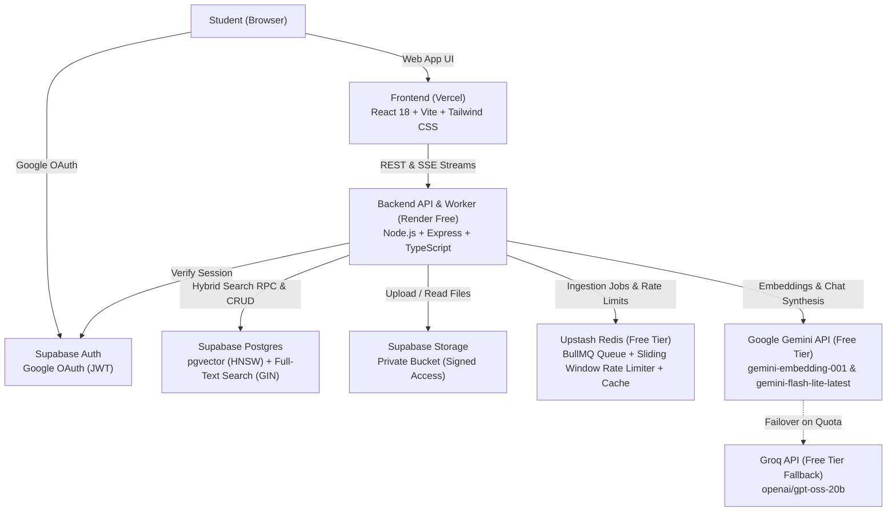
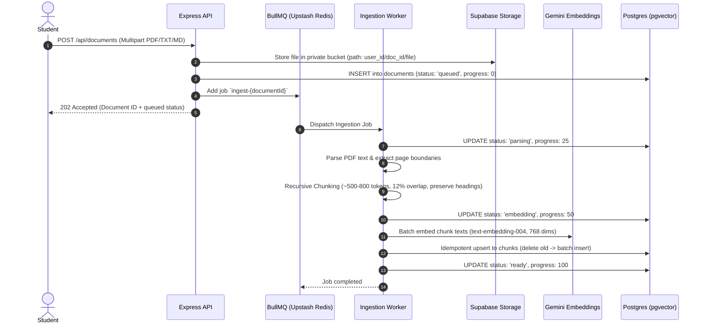
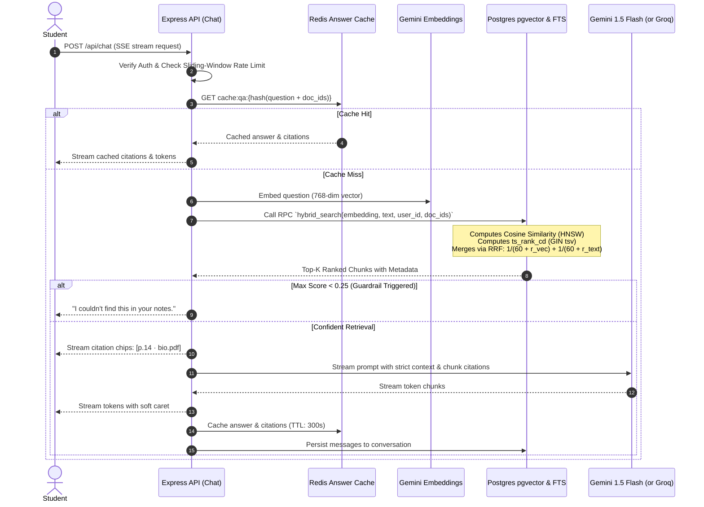

# AskMyNotes System Architecture

AskMyNotes is an SDE-grade, multi-tenant document Q&A and active-recall study platform engineered exclusively on free-tier cloud infrastructure.

---

## 1. High-Level Architecture Diagram



---

## 2. Ingestion Pipeline Flow



### Idempotency Guarantee
Ingestion jobs are fully idempotent:
- BullMQ assigns `jobId: documentId`, preventing duplicate queued executions.
- Before chunk insertion, the worker issues `DELETE FROM chunks WHERE document_id = $id`, ensuring retries or duplicate job deliveries never duplicate vectors or chunks.

---

## 3. Hybrid Retrieval & SSE Query Flow



---

## 4. Multi-Tenancy & Row Level Security (RLS) Model

Supabase Postgres Row Level Security is active on every user-owned table:

```sql
-- Example RLS Policy enforced for Documents
CREATE POLICY "Users can view own documents" ON documents
  FOR SELECT USING (auth.uid() = user_id);

CREATE POLICY "Users can insert own documents" ON documents
  FOR INSERT WITH CHECK (auth.uid() = user_id);

CREATE POLICY "Users can delete own documents" ON documents
  FOR DELETE USING (auth.uid() = user_id);
```

- **Storage Isolation**: Storage policies enforce that users can only upload and read objects within their assigned folder: `(storage.foldername(name))[1] = auth.uid()::text`.
- **Database Isolation**: Foreign keys cascade deletions (`ON DELETE CASCADE`) from documents to chunks, messages, and flashcards. Deleting a document removes all associated vectors and metadata instantly.
- **Service Role**: Backend workers use the Supabase `service_role` key strictly when executing scheduled asynchronous worker jobs that run out-of-band of HTTP requests.

---

## 5. Rate Limiting & Quota Protection

To guarantee 100% operation on free tiers, sliding-window rate limiting is implemented via Upstash Redis sorted sets (`ZSET`):

| Action | Limit | Window | Purpose |
| :--- | :--- | :--- | :--- |
| **Chat Queries** | 20 requests | 60 seconds | Protects Gemini free-tier RPM (15-60 RPM) |
| **Document Uploads** | 10 uploads | 300 seconds | Protects storage footprint & worker compute |
| **Flashcard Gen** | 5 decks | 300 seconds | Conserves LLM output tokens |
| **Quiz Gen** | 5 quizzes | 300 seconds | Conserves LLM output tokens |

When a limit is reached:
- Response returns `HTTP 429 Too Many Requests`.
- Standard `Retry-After: <seconds>` response header is attached.
- Frontend displays an inline countdown toast indicating exactly when queries become available.

---

## 6. Resilience & Swappable LLM Layer

The system defines clean TypeScript interfaces:
- `interface LlmProvider`
- `interface EmbeddingProvider`

If the Google Gemini API returns an error or quota exhaustion (HTTP 429), `ResilientLlmService` automatically fails over to Groq's high-speed free tier (`llama-3.1-8b-instant`) without terminating user connections.
